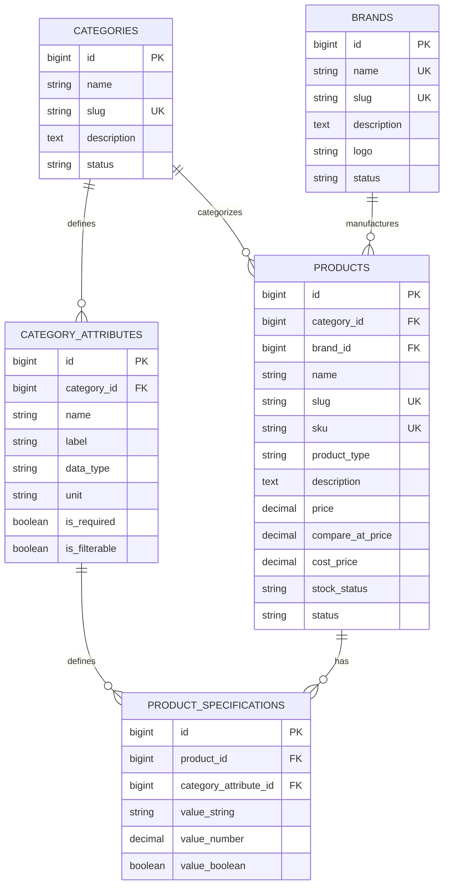

## A. Authentication

- gem "devise"
  - Setup Gemfile and run bundle install
  - Run "_rails generate devise:install"_ to setup devise
  - With exist User model, run "_rails generate migration AddDeviseFieldsToUsers"_

## B. Product related table define

Each product belongs to one category and one brand. Categories define attributes, and product specifications associate a product with a category attribute. The `(category_id, name)` pair on `category_attributes` and `(product_id, category_attribute_id)` pair on `product_specifications` are unique.

## C. Authorization

setup gem file + bundle install

bundle exec rails g pundit:install
